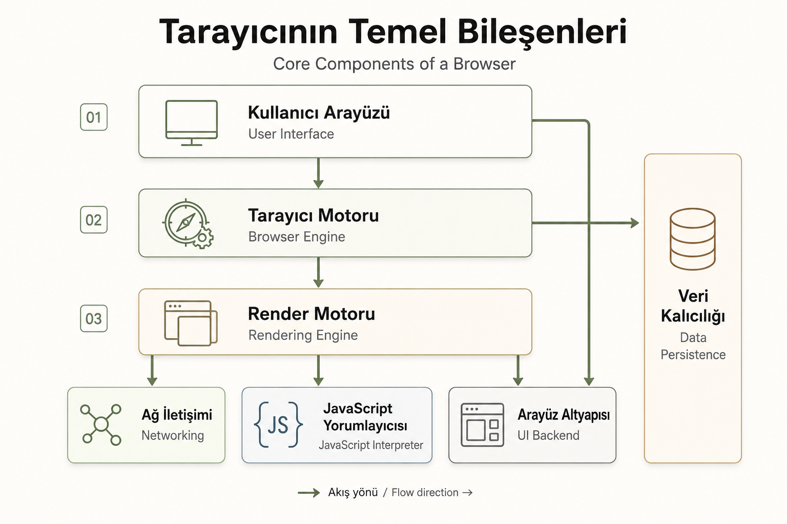

# Tarayıcı Nedir ve Nasıl Çalışır?
Web geliştirirken yazdığımız HTML, CSS ve JavaScript kodlarını kullanıcıya ulaştıran program tarayıcıdır. Bir sayfanın neden geç açıldığını, bir script'in neden hata verdiğini veya bir CSS değişikliğinin neden sayfayı yavaşlattığını anlamak için tarayıcının nasıl çalıştığını bilmek gerekir.

Bu notta tarayıcıyı, adres çubuğuna bir URL yazdığımız andan sayfanın ekrana çizildiği ana kadar adım adım inceleyeceğiz.
```
    Tarayıcı Nedir ve Nasıl Çalışır?
    │
    ├── 1. Tarayıcı Nedir?
    │
    ├── 2. Tarayıcılar ve Tarayıcı Motorları
    │
    ├── 3. Adres Çubuğuna URL Yazdığımızda Ne Olur?
    │   └── URL → DNS → TCP/TLS → HTTP → Sunucu → Render
    │
    ├── 4. Tarayıcının Temel Bileşenleri
    │
    ├── 5. Tarayıcı Sayfayı Nasıl Çizer?
    │   └── DOM → CSSOM → Render Tree → Layout → Paint → Composite
    │
    ├── 6. Tarayıcıda Veri Depolama
    │
    └── 7. Geliştirici Araçları (DevTools)
```

## 1. Tarayıcı Nedir?
**Tarayıcı (browser)**, internetteki web kaynaklarını sunucudan isteyen ve bunları kullanıcıya gösteren programdır.

Tarayıcının temel görevi:
```
    Kullanıcının istediği kaynağı sunucudan iste
            ↓
    Gelen kodu yorumla
            ↓
    Sonucu ekranda göster
```
İstenen kaynak çoğunlukla bir HTML belgesidir ancak PDF, görsel, video veya başka bir içerik türü de olabilir.

**- Tarayıcı ve Arama Motoru Aynı Şey Değildir**
```
    Tarayıcı → Chrome, Firefox, Safari, Edge
    Web sayfalarını açan ve gösteren program

    Arama Motoru → Google, Bing, Yandex
    Web sayfalarını tarayıp arama sonuçları sunan bir web hizmeti
```
Örneğin Chrome bir tarayıcıdır; Google ise Chrome içerisinde açtığımız bir arama motorudur. Arama motorlarının çalışma mantığı **SEONedir.md** notunda incelenmektedir.

## 2. Tarayıcılar ve Tarayıcı Motorları
Günümüzde masaüstünde en yaygın kullanılan tarayıcılar:
- Chrome
- Edge
- Firefox
- Safari
- Opera

Mobil cihazlarda:
- **Android:** Chrome, Samsung Internet, Firefox, Opera
- **iPhone:** Safari, Chrome

Internet Explorer artık Microsoft tarafından desteklenmemektedir ve yerini Edge almıştır.

**- Tarayıcı Motoru Nedir?**

Tarayıcıların arayüzleri farklı görünse de HTML ve CSS'i işleyip sayfayı çizen asıl parça **tarayıcı motorudur (rendering engine).** Farklı markalardaki birçok tarayıcı aynı motoru kullanır.

| Tarayıcı                         | Motor    | Açıklama                              |
|----------------------------------|----------|---------------------------------------|
| Chrome, Edge, Opera, Samsung Internet | Blink | Chromium tabanlı modern motor      |
| Firefox                          | Gecko    | Mozilla tarafından geliştirilmiştir   |
| Safari                           | WebKit   | Apple cihazlarında kullanılır         |
| Edge (eski)                      | EdgeHTML | Artık kullanılmıyor                   |

Bu tablo frontend geliştirici için önemlidir. Bir CSS özelliği Chrome'da çalışıp Safari'de çalışmıyorsa sebep genellikle markadan değil, **motorlar arasındaki destek farkından** kaynaklanır. Bu nedenle sayfalar en az üç motorda (Blink, Gecko, WebKit) test edilmelidir.

**Not:** iPhone'da Chrome kullanıldığında bile sayfa uzun yıllar boyunca Apple'ın kuralları gereği **WebKit** ile çizilmiştir. Bu yüzden iPhone'daki Chrome'da görülen bir sorun, genellikle Safari'de de görülür.

Bir özelliğin hangi tarayıcılarda desteklendiğini kontrol etmek için **caniuse.com** veya **MDN** sayfalarındaki uyumluluk tabloları kullanılabilir.

## 3. Adres Çubuğuna URL Yazdığımızda Ne Olur?
Kullanıcı tarayıcıya `https://example.com/urunler` yazıp Enter'a bastığında sayfanın ekranda görünmesi için arka planda birçok adım gerçekleşir. Bu adımların her biri ayrı bir notta ayrıntılı olarak incelenmektedir; burada bunları baştan sona birbirine bağlayacağız.
```
    1. URL yazılır ve ayrıştırılır
            ↓
    2. Önbellek kontrol edilir
            ↓
    3. DNS ile alan adı IP adresine çevrilir
            ↓
    4. Sunucuyla bağlantı kurulur (TCP + TLS)
            ↓
    5. HTTP isteği gönderilir
            ↓
    6. Sunucu yanıt verir
            ↓
    7. Tarayıcı sayfayı oluşturur ve çizer
```

### 1. URL Yazılır ve Ayrıştırılır
**URL (Uniform Resource Locator)**, bir kaynağın internetteki adresidir. Tarayıcı önce yazılan ifadenin bir URL mi yoksa arama kelimesi mi olduğuna karar verir. URL ise onu parçalarına ayırır:
```
    https://www.example.com:443/urunler?renk=siyah#yorumlar
    │       │               │   │       │          │
    │       │               │   │       │          └── Fragment: Sayfa içi bölüm
    │       │               │   │       └── Query: Ek parametreler
    │       │               │   └── Path: Sunucudaki kaynak yolu
    │       │               └── Port: (HTTPS için varsayılan 443, genellikle yazılmaz)
    │       └── Domain: Alan adı
    └── Protokol: İletişim kuralı
```
`#yorumlar` kısmı sunucuya gönderilmez; tarayıcı sayfa yüklendikten sonra ilgili bölüme gitmek için kullanır. Bu konu **04_HTMLdeBaglantilarveNavigasyon** notundaki sayfa içi bağlantılarla ilişkilidir.

### 2. Önbellek Kontrol Edilir
Tarayıcı, istenen kaynağın daha önce indirilmiş ve hâlâ geçerli bir kopyasının kendi önbelleğinde (cache) olup olmadığına bakar. Geçerli bir kopya varsa ağa hiç çıkmadan onu kullanabilir. Bu konu aşağıdaki **Tarayıcıda Veri Depolama** bölümünde ele alınmaktadır.

### 3. DNS Çözümleme
Bilgisayarlar alan adlarıyla değil, IP adresleriyle iletişim kurar. Tarayıcı `example.com` adresinin hangi sunucuya ait olduğunu öğrenmek için **DNS (Domain Name System)** sorgusu yapar.
```
    example.com → DNS → 93.184.216.34 (örnek bir IP adresi)
```
Tarayıcı ve işletim sistemi önce kendi DNS önbelleklerine bakar; sonuç yoksa sorgu sırasıyla recursive, root, TLD ve authoritative DNS sunucularına iletilir.

**Ayrıntılı bilgi:** DomainName.md → DNS (Domain Name System) Nedir?

### 4. Sunucuyla Bağlantı Kurulur (TCP + TLS)
IP adresi bulunduktan sonra tarayıcı sunucuyla bir bağlantı kurar.
```
    TCP Bağlantısı
    └── Verinin eksiksiz ve doğru sırayla iletilmesini sağlayan bağlantı kurulur.

    TLS El Sıkışması (yalnızca HTTPS'te)
    └── Tarayıcı ve sunucu şifreleme anahtarları üzerinde anlaşır,
        sunucunun sertifikası doğrulanır.
```
TLS sayesinde aradaki veriler şifrelenir ve tarayıcı gerçekten doğru siteyle konuştuğundan emin olur. Adres çubuğundaki kilit simgesi bu doğrulamanın başarılı olduğunu gösterir.

**Not:** Modern **HTTP/3** protokolü TCP yerine **QUIC** adı verilen farklı bir yapı kullanarak bu bağlantı adımlarını hızlandırır. Temel mantık yine aynıdır: Önce güvenli bir bağlantı kurulur, sonra veri gönderilir.

**Ayrıntılı bilgi:** HttpNedir.md → HTTP vs HTTPS

### 5. HTTP İsteği Gönderilir
Bağlantı kurulduktan sonra tarayıcı sunucuya bir **HTTP isteği (request)** gönderir:
```
    GET /urunler HTTP/1.1
    Host: www.example.com
    Accept: text/html
    Accept-Language: tr-TR
    Cookie: session=abc123
```
Burada tarayıcı `/urunler` sayfasını istediğini, HTML kabul ettiğini ve Türkçe içeriği tercih ettiğini söyler. Bu siteye ait çerezler (cookies) varsa onlar da otomatik olarak isteğe eklenir.

**Ayrıntılı bilgi:** HttpNedir.md → HTTP İstek - Yanıt Modeli, HTTP Metotları

### 6. Sunucu Yanıt Verir
İstek, sitenin barındırıldığı (hosting) sunucuya ulaşır. Sunucu isteği işler ve bir **HTTP yanıtı (response)** döndürür:
```
    HTTP/1.1 200 OK
    Content-Type: text/html; charset=UTF-8
    Cache-Control: max-age=3600

    <!DOCTYPE html>
    <html lang="tr">
    ...
```
Yanıtın ilk satırındaki **durum kodu** sonucun ne olduğunu belirtir:
```
    200 → Başarılı
    301 → Sayfa kalıcı olarak başka adrese taşındı
    404 → Sayfa bulunamadı
    500 → Sunucu hatası
```
**Ayrıntılı bilgi:** HttpNedir.md → HTTP Durum Kodları, HostingNedir.md

### 7. Tarayıcı Sayfayı Oluşturur
Tarayıcı gelen HTML'i okumaya başlar. HTML içerisinde CSS, JavaScript, görsel ve font gibi başka kaynaklara bağlantılar buldukça bunlar için de **yeni HTTP istekleri** gönderir.
```
    index.html
    │
    ├── style.css   → Yeni istek
    ├── app.js      → Yeni istek
    ├── logo.png    → Yeni istek
    └── font.woff2  → Yeni istek
```
Yani tek bir sayfa açmak çoğu zaman onlarca isteğin gönderilmesi anlamına gelir. Geliştirici araçlarının **Network** panelinde bu isteklerin tamamı görülebilir.

Tarayıcının bu kaynakları kullanarak sayfayı nasıl çizdiği **5. Tarayıcı Sayfayı Nasıl Çizer?** bölümünde ayrıntılı olarak incelenmektedir.

## 4. Tarayıcının Temel Bileşenleri


Bir tarayıcı birlikte çalışan birçok bileşenden oluşur:
```
    Tarayıcı
    │
    ├── Kullanıcı Arayüzü (User Interface)
    │
    ├── Tarayıcı Motoru (Browser Engine)
    │
    ├── Oluşturma Motoru (Rendering Engine)
    │
    ├── Ağ (Networking)
    │
    ├── JavaScript Motoru (JavaScript Engine)
    │
    ├── Arayüz Arka Ucu (UI Backend)
    │
    └── Veri Depolama (Data Persistence)
```

**- Kullanıcı Arayüzü (User Interface)**

Kullanıcının tarayıcıyla etkileşim kurduğu bölümdür. Adres çubuğu, geri-ileri butonları, yer imleri, sekmeler ve yükleme göstergesi bu bölüme aittir. Sayfanın kendisi bu bölüme dahil değildir.

**- Tarayıcı Motoru (Browser Engine)**

Kullanıcı arayüzü ile oluşturma motoru arasında köprü görevi görür. Örneğin kullanıcı geri butonuna bastığında bu işlemi alır ve oluşturma motoruna iletir.

**- Oluşturma Motoru (Rendering Engine)**

HTML ve CSS kodlarını alır, ayrıştırır (parse eder) ve kullanıcıya görsel bir sayfa olarak sunar. Örneğin `<h1>Merhaba</h1>` kodunu büyük ve kalın bir **Merhaba** yazısına dönüştüren bu bileşendir. Yukarıdaki tabloda gördüğümüz Blink, Gecko ve WebKit birer oluşturma motorudur.

**- Ağ (Networking)**

Tarayıcının internete bağlanıp HTML, CSS, JavaScript, görsel gibi dosyaları sunucudan getirdiği bileşendir. HTTP/HTTPS isteklerini ve JavaScript'teki `fetch` isteklerini yönetir.

**- JavaScript Motoru (JavaScript Engine)**

Sayfadaki JavaScript kodlarını çalıştıran bileşendir. Butona tıklama, form kontrolü, animasyon gibi etkileşimleri sağlar.
```
    Chrome / Edge → V8
    Firefox       → SpiderMonkey
    Safari        → JavaScriptCore
```
Node.js de JavaScript kodunu tarayıcı dışında çalıştırmak için Chrome'un V8 motorunu kullanır.

**- Arayüz Arka Ucu (UI Backend)**

Açılır menüler, kaydırma çubukları, form kontrolleri gibi temel arayüz elemanlarını işletim sisteminin grafik altyapısını kullanarak çizer. Form elementlerinin farklı işletim sistemlerinde farklı görünmesinin sebeplerinden biri budur.

**- Veri Depolama (Data Persistence)**

Çerezler, localStorage, IndexedDB ve önbellek gibi verilerin tarayıcıda saklandığı bölümdür. Ayrıntıları **6. Tarayıcıda Veri Depolama** bölümünde incelenmektedir.

## 5. Tarayıcı Sayfayı Nasıl Çizer?
**00_HTMLTemelleri** notunda tarayıcının HTML'den bir **DOM** ağacı oluşturduğunu ve sayfanın bu ağacın üzerine CSS uygulanarak çizildiğini görmüştük. Bu süreç aslında birkaç aşamadan oluşur. Bu aşamaların tamamına **Critical Rendering Path (Kritik Oluşturma Yolu)** denir.
```
    HTML ──→ DOM ─────┐
                      ├──→ Render Tree ──→ Layout ──→ Paint ──→ Composite
    CSS  ──→ CSSOM ───┘
```

### 1. DOM Oluşturulur
Tarayıcı HTML kodunu yukarıdan aşağıya okur ve her elementi bir **düğüm (node)** olarak temsil eden **DOM (Document Object Model)** ağacını oluşturur.
```
    <body>
        <h1>Ürünler</h1>
        <p class="note">Yeni sezon</p>
    </body>
```
```
    body
    ├── h1
    │   └── "Ürünler"
    └── p.note
        └── "Yeni sezon"
```

### 2. CSSOM Oluşturulur
Tarayıcı aynı şekilde CSS kodlarını da okur ve **CSSOM (CSS Object Model)** adı verilen bir yapı oluşturur. CSSOM, hangi elemente hangi stillerin uygulanacağını tutar. Cascade ve specificity kuralları bu aşamada değerlendirilir.

**03_CSS/02_CascadeveSpecificity** notunda öğrendiğimiz kurallar tarayıcının bu adımda yaptığı hesaplamalardır.

### 3. Render Tree Oluşturulur
DOM ve CSSOM birleştirilerek **ekranda gerçekten görünecek** elementlerden oluşan **Render Tree** oluşturulur.
```
    <head>, <script>, <meta>   → Render Tree'ye eklenmez.
    display: none              → Render Tree'ye eklenmez.
    visibility: hidden         → Eklenir. Yer kaplar ama görünmez.
```
`display: none` ile `visibility: hidden` arasındaki farkın kaynağı budur: Biri sayfadan tamamen çıkarılır, diğeri ise yerini korur.

### 4. Layout (Yerleşim)
Tarayıcı Render Tree'deki her elementin **sayfadaki konumunu ve boyutunu** hesaplar. Box model, `display`, `position`, Flexbox ve Grid kuralları bu aşamada uygulanır.
```
    h1 → x: 0, y: 0, genişlik: 1200px, yükseklik: 48px
    p  → x: 0, y: 64px, genişlik: 1200px, yükseklik: 24px
```
Bu aşamaya **reflow** da denir.

### 5. Paint (Boyama)
Konumu ve boyutu belli olan elementlerin renkleri, metinleri, kenarlıkları, gölgeleri ve görselleri piksellere dönüştürülür.

### 6. Composite (Birleştirme)
Sayfa bazı durumlarda birden fazla **katman (layer)** halinde çizilir. Örneğin sabit bir menü veya animasyonlu bir element ayrı bir katmanda olabilir. Bu aşamada katmanlar doğru sırayla birleştirilerek ekrana son hali verilir.

### CSS Render'ı Engeller
Tarayıcı CSSOM hazır olmadan sayfayı çizmez. Çünkü CSS gelmeden çizilen bir sayfa, CSS geldikten sonra tamamen değişerek kullanıcıya bir an stilsiz bir sayfa gösterebilir. Bu nedenle CSS **render-blocking** bir kaynaktır.

Bu da CSS dosyalarının `<head>` içerisinde, mümkün olduğunca erken yüklenmesinin nedenidir.

### JavaScript HTML Okumayı Engeller
Tarayıcı `defer` veya `async` içermeyen bir `<script>` ile karşılaştığında HTML okumayı durdurur, script'i indirir ve çalıştırır. Çünkü JavaScript DOM'u değiştirebilir. Bu nedenle JavaScript varsayılan olarak **parser-blocking** bir kaynaktır.
```
    CSS        → Render-blocking (sayfanın çizilmesini bekletir)
    JavaScript → Parser-blocking (HTML'in okunmasını bekletir)
```
Bu davranışın `defer` ve `async` ile nasıl yönetildiği **04_HTML/18_HTML'eJavaScriptEklemek** notunda ayrıntılı olarak incelenmektedir.

### Reflow ve Repaint
Sayfa ilk kez çizildikten sonra JavaScript veya kullanıcı etkileşimiyle bir şey değiştiğinde tarayıcı bu aşamaların bir kısmını tekrar yapmak zorunda kalır.
```
    width, height, margin, padding, font-size, top, left değişirse
    → Layout + Paint + Composite (Reflow)
    → En maliyetli durum

    color, background-color, box-shadow değişirse
    → Paint + Composite (Repaint)
    → Daha az maliyetli

    transform, opacity değişirse
    → Yalnızca Composite
    → En hafif durum
```
Bir elementin genişliği değiştiğinde yalnızca o element değil, yanındaki ve altındaki elementlerin konumları da yeniden hesaplanabilir. Bu nedenle animasyonlarda bir elementi hareket ettirmek için `left` / `top` yerine `transform: translate()` kullanmak daha performanslıdır.

Görsellere `width` ve `height` vermenin sayfa kaymasını (CLS) önlemesi de bu süreçle ilişkilidir: Tarayıcı görsel inmeden önce onun için yer ayırabildiğinde görsel geldiğinde tekrar layout hesaplaması gerekmez.

## 6. Tarayıcıda Veri Depolama
Tarayıcı, sayfalar arasında bilgi taşımak, kullanıcı tercihlerini hatırlamak veya sayfayı daha hızlı açmak için verileri saklayabilir.
```
    Tarayıcıda Veri Depolama
    │
    ├── Çerezler (Cookies)
    ├── localStorage
    ├── sessionStorage
    ├── IndexedDB
    └── Önbellek (Cache)
```

### Çerezler (Cookies)
Tarayıcının sakladığı küçük veri parçalarıdır. Oturum bilgisi, dil tercihi veya kullanıcı kimliği gibi küçük bilgiler için kullanılır.
- Her çerez yaklaşık **4 KB** ile sınırlıdır.
- İlgili siteye yapılan **her HTTP isteğiyle birlikte otomatik olarak sunucuya gönderilir.**
- Süresi belirtilmezse tarayıcı kapanınca silinir (session cookie); süre verilirse o tarihe kadar saklanır (persistent cookie).
- JavaScript ile `document.cookie` üzerinden okunabilir ve yazılabilir.

Kullanım alanları:
- Giriş yapmış kullanıcıyı hatırlamak,
- Dil ve tema tercihlerini korumak,
- Ziyaretçi davranışlarını analiz etmek.

**- Çerezlerde Güvenlik Seçenekleri**

Sunucu bir çerez oluştururken ek ayarlar verebilir:
```
    HttpOnly → Çerez JavaScript ile okunamaz. Oturum çerezlerini korumak için kullanılır.
    Secure   → Çerez yalnızca HTTPS bağlantılarında gönderilir.
    SameSite → Çerezin başka sitelerden gelen isteklerde gönderilip gönderilmeyeceğini belirler.
```

### localStorage
JavaScript ile tarayıcıda kalıcı veri saklamayı sağlayan daha modern bir yöntemdir.
```
    localStorage.setItem("theme", "dark");
    localStorage.getItem("theme"); // "dark"
```
- Tarayıcıya göre yaklaşık **5-10 MB** alan sunar.
- Sunucuya otomatik olarak **gönderilmez.**
- Veriler kalıcıdır; kullanıcı veya kod silene kadar tarayıcı kapansa bile kalır.
- Yalnızca aynı **origin** (protokol + alan adı + port) tarafından erişilebilir.
- Yalnızca metin (string) saklar. Nesneler `JSON.stringify()` ile metne çevrilerek saklanır.

### sessionStorage
localStorage ile aynı şekilde kullanılır ancak veriler yalnızca **o sekme açık kaldığı sürece** saklanır. Sekme kapatıldığında silinir ve başka sekmelerle paylaşılmaz.

Örneğin çok adımlı bir formda kullanıcının girdiği bilgileri adımlar arasında geçici olarak tutmak için kullanılabilir.

### IndexedDB
Tarayıcı içerisinde büyük ve karmaşık verileri saklamak için kullanılan bir veritabanıdır. Web uygulamalarının çevrimdışı çalışabilmesini sağlayabilir.
- Yüzlerce MB'lık veri saklanabilir.
- Nesneleri doğrudan, anahtar-değer (key-value) yapısıyla saklar.
- Asenkron çalışır; veriye erişmek sayfayı dondurmaz.
- API'si localStorage'a göre daha karmaşıktır.

### Önbellek (Cache)
Daha önce indirilen HTML, CSS, JavaScript, görsel gibi dosyaların geçici olarak saklandığı alandır. Sayfanın daha hızlı açılmasını, sunucu yükünün ve mobil veri tüketiminin azalmasını sağlar.
- **HTTP Cache:** Sunucunun gönderdiği `Cache-Control` gibi response header'larına göre tarayıcı tarafından otomatik olarak yönetilir.
- **Service Worker Cache (Cache API):** JavaScript ile yönetilen önbellektir. Çevrimdışı çalışabilen uygulamalarda (PWA) kullanılır.

### Karşılaştırma
| Özellik                 | Cookie            | localStorage     | sessionStorage   | IndexedDB        |
|-------------------------|-------------------|------------------|------------------|------------------|
| Kapasite                | ~4 KB             | ~5-10 MB         | ~5-10 MB         | Yüzlerce MB      |
| Sunucuya gönderilir mi? | Evet, her istekte | Hayır            | Hayır            | Hayır            |
| Ne zaman silinir?       | Belirlenen sürede | Silinene kadar kalır | Sekme kapanınca | Silinene kadar kalır |
| Kullanım                | Oturum, tercihler | Tema, ayarlar    | Geçici form verisi | Büyük / çevrimdışı veri |

**- Hassas Bilgiler Tarayıcıda Saklanmamalıdır**

localStorage, sessionStorage ve IndexedDB'deki veriler sayfada çalışan **her JavaScript kodu** tarafından okunabilir. Sayfaya zararlı bir script eklenirse (XSS saldırısı) bu veriler çalınabilir. Bu nedenle şifre, kart bilgisi gibi hassas veriler bu alanlarda saklanmamalıdır. Oturum bilgileri için genellikle `HttpOnly` çerezler tercih edilir.

## 7. Geliştirici Araçları (DevTools)
Her modern tarayıcıda geliştiricilerin sayfayı incelemesi, test etmesi ve hata ayıklaması için araçlar bulunur.
```
    Google Chrome   → Chrome DevTools
    Mozilla Firefox → Firefox Developer Tools
    Microsoft Edge  → Edge DevTools
    Safari          → Web Inspector
```
Açmak için:
- **F12** tuşuna basılabilir,
- Sayfada sağ tıklayıp **İncele** seçilebilir,
- macOS'ta **Cmd + Option + I** kısayolu kullanılabilir.

Safari'de geliştirici araçlarını kullanabilmek için önce ayarlardan **Gelişmiş → Web geliştiricileri için özellikleri göster** seçeneği açılmalıdır.

### Paneller
**- Elements (Öğeler)**

Sayfanın DOM yapısını ve elementlere uygulanan CSS kurallarını gösterir. HTML ve CSS anlık olarak değiştirilerek denenebilir. Burada gördüğümüz yapı yazdığımız HTML dosyası değil, tarayıcının oluşturduğu **güncel DOM ağacıdır.** JavaScript ile yapılan değişiklikler de burada görünür.

**- Console (Konsol)**

JavaScript kodlarının çalıştırılabildiği alandır. Hataları (error), uyarıları (warning) ve `console.log()` çıktılarını gösterir.

**- Sources (Kaynaklar)**

Sayfanın yüklediği JavaScript ve CSS dosyalarını gösterir. JavaScript kodlarına **breakpoint** koyarak kodun belirli bir satırda durdurulması ve adım adım incelenmesi sağlanabilir.

**- Network (Ağ)**

Sayfanın yaptığı tüm HTTP isteklerini gösterir. Her isteğin:
- Durum kodunu (200, 404...),
- Boyutunu,
- Ne kadar sürede tamamlandığını,
- İstek ve yanıt header'larını

incelemek mümkündür. API'den veri çekildiğinde gelen yanıtlar da buradan izlenebilir. Yavaş bağlantı simülasyonu (örneğin "Slow 4G") yapılarak sayfanın yavaş internette nasıl davrandığı test edilebilir.

**- Application (Uygulama)**

Çerezler, localStorage, sessionStorage, IndexedDB ve önbellek gibi tarayıcıda saklanan verileri gösterir. Veriler buradan görüntülenebilir, değiştirilebilir veya silinebilir.

**- Performance (Performans)**

Sayfanın yüklenmesi ve çalışması sırasında tarayıcının ne yaptığını zaman çizelgesi üzerinde gösterir. Yukarıda gördüğümüz layout, paint gibi aşamaların ne kadar sürdüğü ve hangi işlemlerin sayfayı yavaşlattığı burada analiz edilebilir.

**- Lighthouse**

Sayfanın performans, erişilebilirlik, en iyi uygulamalar ve SEO puanlarını ölçer ve iyileştirme önerileri sunar.

**- Security (Güvenlik)**

Sayfanın HTTPS kullanıp kullanmadığını, sertifika bilgilerini ve karışık içerik (HTTPS sayfasında HTTP ile yüklenen kaynaklar) sorunlarını gösterir.

**- Memory (Bellek)**

Sayfanın ne kadar bellek (RAM) kullandığını gösterir ve bellek sızıntısı gibi sorunların bulunmasına yardımcı olur.

**- Device Toolbar (Cihaz Görünümü)**

Sayfanın farklı ekran boyutlarında ve mobil cihazlarda nasıl göründüğünü test etmeyi sağlar. Chrome'da **Ctrl + Shift + M** (macOS'ta **Cmd + Shift + M**) ile açılabilir. Responsive tasarım yaparken en sık kullanılan araçlardan biridir.

## Kısaca Özet
- **Tarayıcı**, web kaynaklarını sunucudan isteyip kullanıcıya gösteren programdır. Arama motoru ile aynı şey değildir.
- Farklı tarayıcılar aynı **motoru** kullanabilir: Blink (Chrome, Edge, Opera), Gecko (Firefox), WebKit (Safari).
- Bir URL yazıldığında:
```
    URL ayrıştırılır
    ↓
    Önbellek kontrol edilir
    ↓
    DNS ile IP adresi bulunur
    ↓
    TCP + TLS ile güvenli bağlantı kurulur
    ↓
    HTTP isteği gönderilir
    ↓
    Sunucu HTTP yanıtı döndürür
    ↓
    Tarayıcı sayfayı oluşturur
```
- Tarayıcı sayfayı şu aşamalarla çizer:
```
    HTML → DOM
    CSS  → CSSOM
    DOM + CSSOM → Render Tree → Layout → Paint → Composite
```
- CSS **render-blocking**, `defer`/`async` olmayan JavaScript ise **parser-blocking** bir kaynaktır.
- Boyut ve konum değişiklikleri **reflow**, renk değişiklikleri **repaint** gerektirir; `transform` ve `opacity` en hafif değişikliklerdir.
- Tarayıcı verileri **cookie**, **localStorage**, **sessionStorage**, **IndexedDB** ve **cache** ile saklayabilir. Hassas veriler JavaScript'in erişebildiği alanlarda tutulmamalıdır.
- **Geliştirici araçları** sayfanın DOM'unu, ağ isteklerini, saklanan verileri ve performansını incelemek için kullanılır.

## Kaynakça
- **web.dev:** https://web.dev/articles/howbrowserswork?hl=tr
- **MDN — How browsers work:** https://developer.mozilla.org/en-US/docs/Web/Performance/How_browsers_work
- **Medium:** https://medium.com/sahibinden-technology/web-tarayıcılar-nasıl-çalışır-e71c77710419
